<div align="center">


# Astian Maps Web

Mapa web y planificador de rutas abierto. Búsqueda, lugares cercanos, rutas con paradas, capas, reportes de la comunidad en vivo y continuidad hacia la app Android.

[Astian Maps Android](https://github.com/goastian/astian-maps-android) · [Repositorio web](https://github.com/goastian/astian-maps-web)

</div>

Cliente Next.js 15 y React 19 con render MapLibre GL, datos de OpenStreetMap y esquema
OpenMapTiles. No usa SDK de ejecución de Google Maps ni de Mapbox. Forma parte del monorepo
de Astian Maps: comparte contratos, traducciones, estilos y tokens de diseño con el gateway
FastAPI (`services/api`) y con el cliente nativo Android.

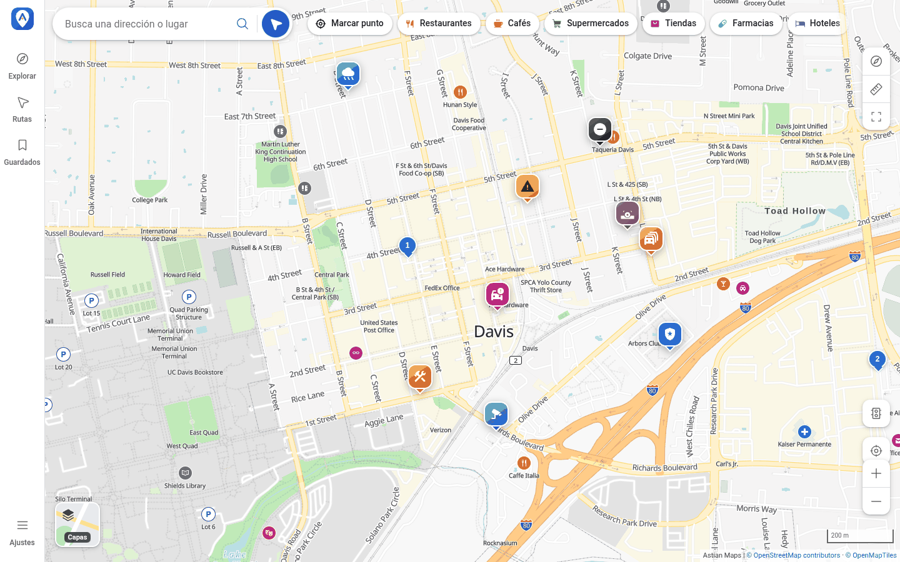

## Qué hace

- **Mapa vectorial** con temas claro, oscuro y de navegación, e interfaz en español, inglés,
  francés y alemán.
- **Búsqueda** de direcciones y lugares, y categorías de lugares cercanos (restaurantes, cafés,
  supermercados, tiendas, farmacias, hoteles, combustible y cargadores).
- **Ficha de lugar** con dirección, horario, teléfono, coordenadas, reseñas y atribución de los
  datos abiertos.
- **Rutas** en coche, bicicleta o a pie, con paradas intermedias, alternativas, opciones para
  evitar peajes, autopistas y ferris, e indicaciones paso a paso.
- **Reportes de la comunidad** en vivo sobre el mapa: tráfico, policía, accidentes, peligros,
  baches, obras, cortes, clima y cámaras.
- **Capas**: carretera, satélite, terreno, rutas ciclistas, cargadores eléctricos, tráfico en
  tiempo real, edificios 3D y calidad del aire. Las capas de evaluación están desactivadas en
  producción.
- **Compartir y continuar en Android**: una URL canónica v1 lleva el plan completo (origen,
  destino, paradas, modo, preferencias y capas) y se abre en la app.
- **Modo de bajo consumo**, lugares guardados, medición de distancias y pantalla completa.
- **Responsive**: panel lateral en escritorio y barra inferior en móvil.

## Reportes de la comunidad

La web muestra los reportes activos de la zona visible y los mantiene al día con el flujo de
eventos de la API (`/v1/incidents/stream`). Cada reporte tiene un color propio, se atenúa
mientras nadie lo ha confirmado y se agrupa en círculos con contador al alejar el zoom. Un
tramo con tráfico se pinta de ámbar a rojo oscuro según el nivel, un corte lleva franjas
rojas y blancas, y unas obras, naranjas y blancas.

Los reportes **solo se leen en la web**. Se crean y se confirman desde
[Astian Maps Android](https://github.com/goastian/astian-maps-android), y aparecen en el mapa
web en cuanto se envían. No hay cuenta ni se guarda la IP: el servidor conserva únicamente un
hash con sal de una clave aleatoria que el cliente renueva cada día.

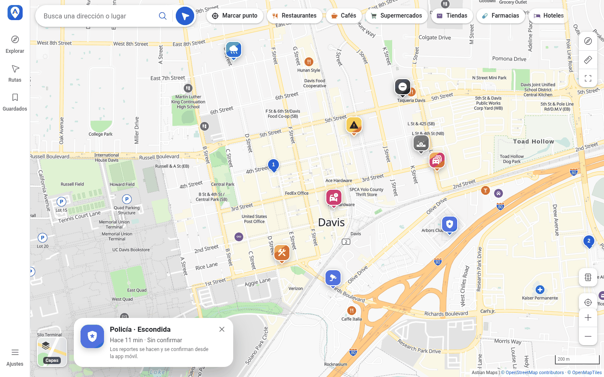

Tipos de reporte: tráfico, policía, accidente, peligro, bache, obras, vía cerrada, clima y
cámara.

## Capturas de la web

Todas las capturas usan datos de prueba en Davis, California.

| Búsqueda por categoría | Ficha de lugar |
| :---: | :---: |
| 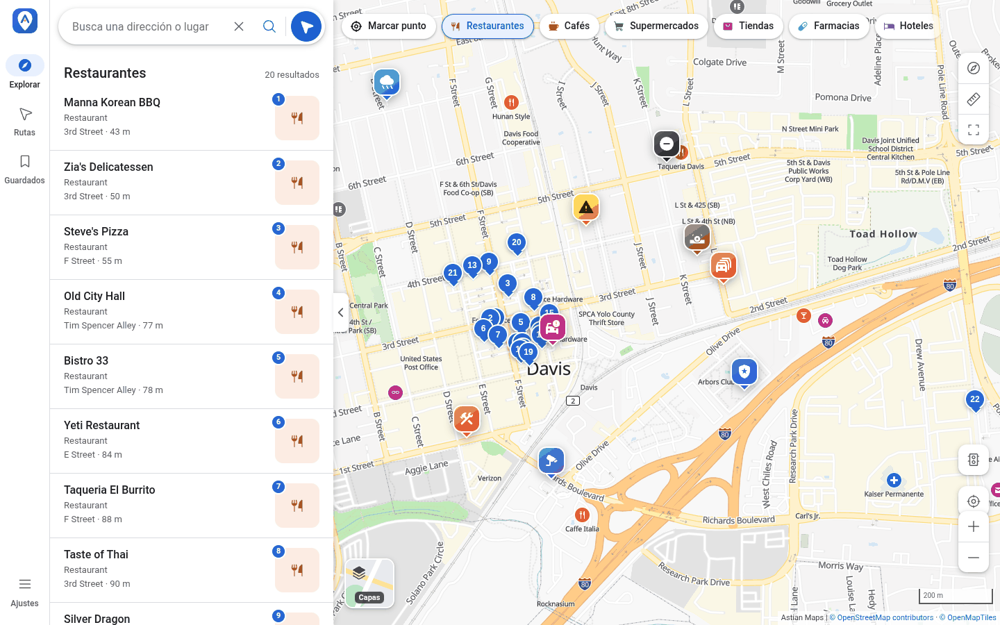 | 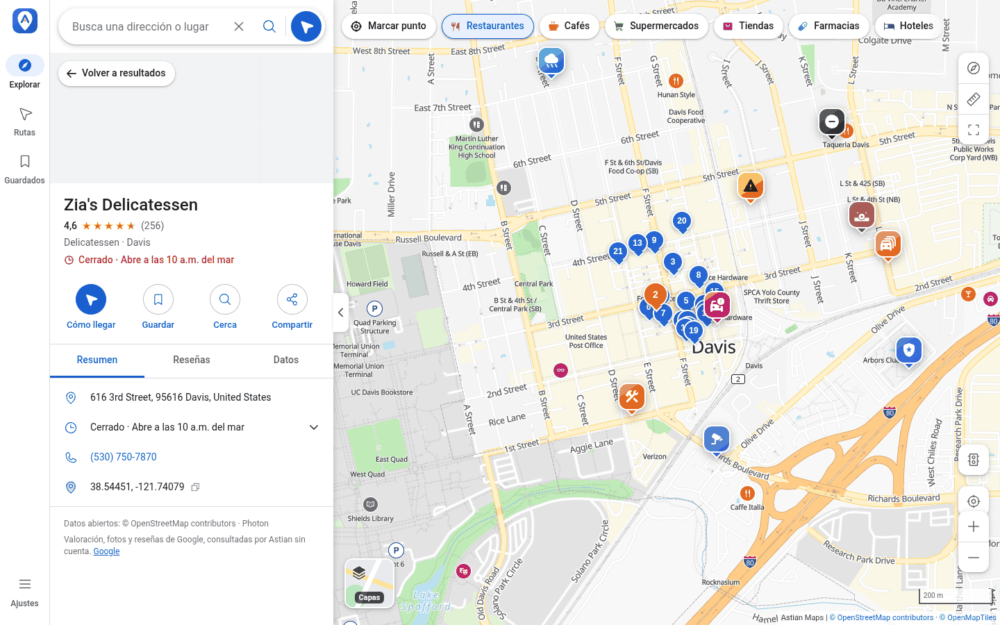 |

| Ruta con indicaciones | Capas del mapa |
| :---: | :---: |
| 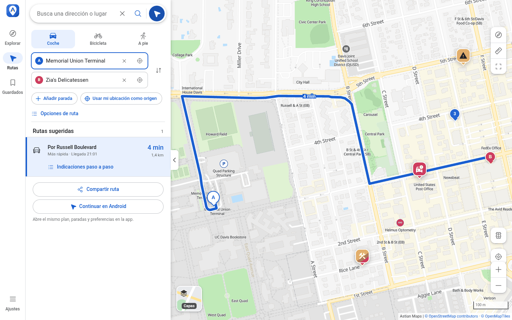 | 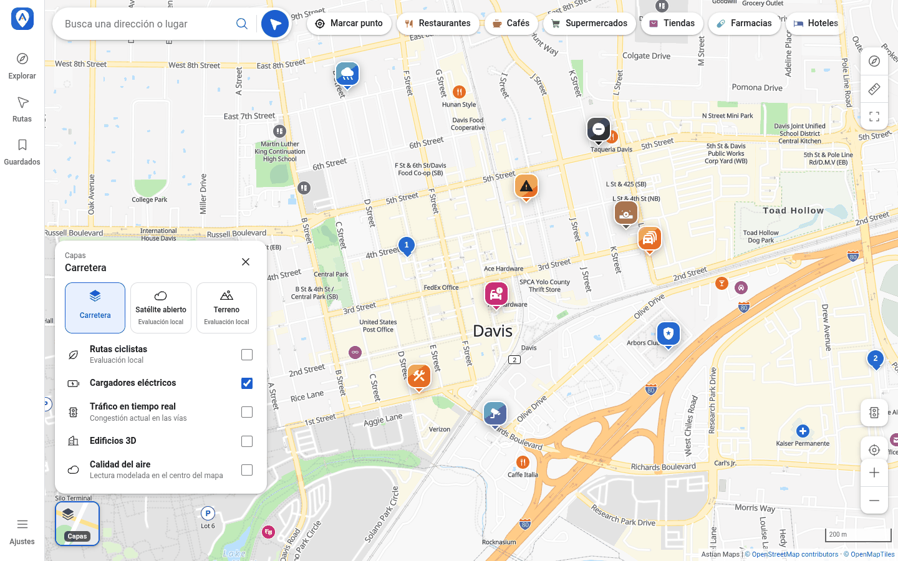 |

### En el móvil

<table>
  <tr>
    <td align="center">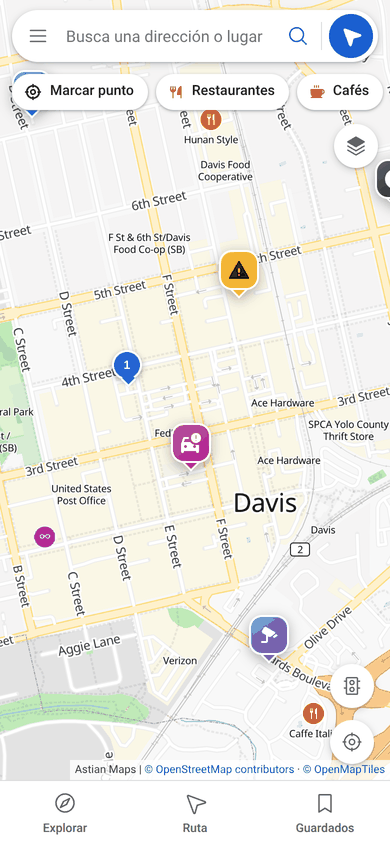</td>
    <td align="center">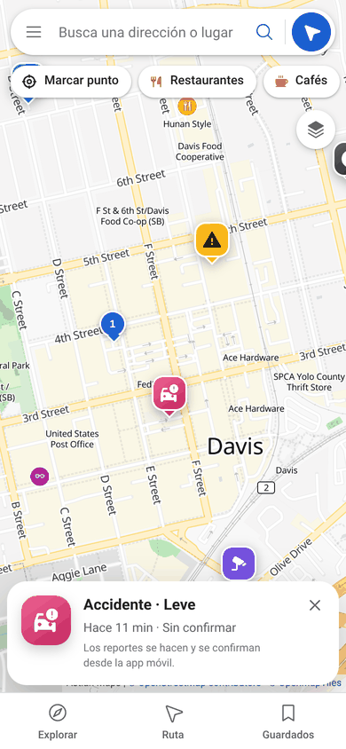</td>
  </tr>
  <tr>
    <td align="center">Mapa con reportes y barra inferior</td>
    <td align="center">Detalle de un reporte</td>
  </tr>
</table>

## Astian Maps Android

El mismo mapa, las mismas rutas y los mismos reportes, en una app nativa: Kotlin, Jetpack
Compose y MapLibre Native, sin Google SDK ni Play Services. Añade navegación giro a giro con
guía de carriles y voz local, regiones sin conexión (mapa, búsqueda y rutas), transporte
público, Android Auto y el botón para **hacer y confirmar reportes** mientras conduces.

Repositorio: **[goastian/astian-maps-android](https://github.com/goastian/astian-maps-android)**
(paquete `org.astian.suite.maps`).

<table>
  <tr>
    <td align="center">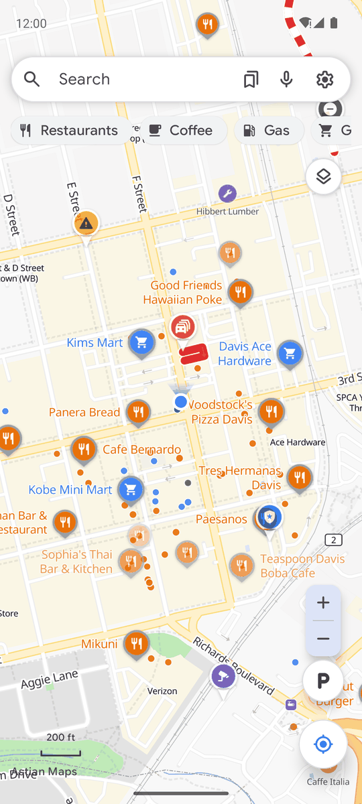</td>
    <td align="center"></td>
    <td align="center">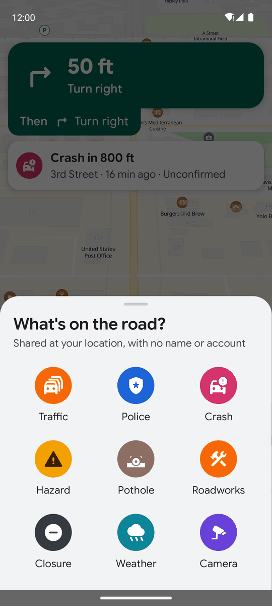</td>
    <td align="center">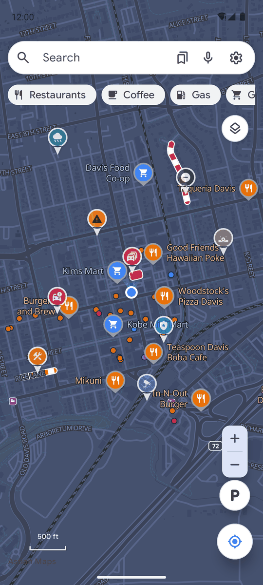</td>
  </tr>
  <tr>
    <td align="center">Reportes en el mapa</td>
    <td align="center">Confirmar un reporte</td>
    <td align="center">Hacer un reporte</td>
    <td align="center">Tema oscuro</td>
  </tr>
</table>

<table>
  <tr>
    <td align="center">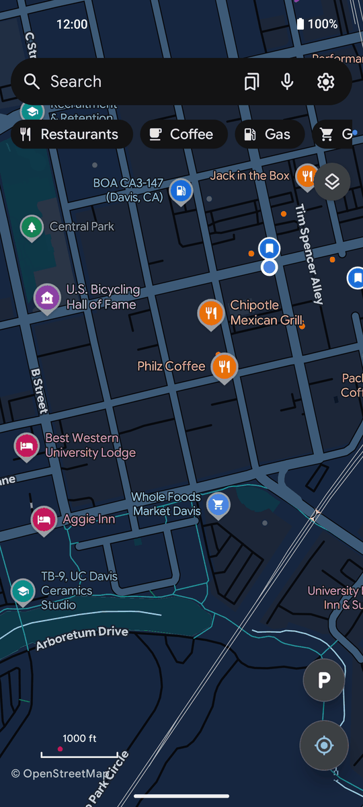</td>
    <td align="center">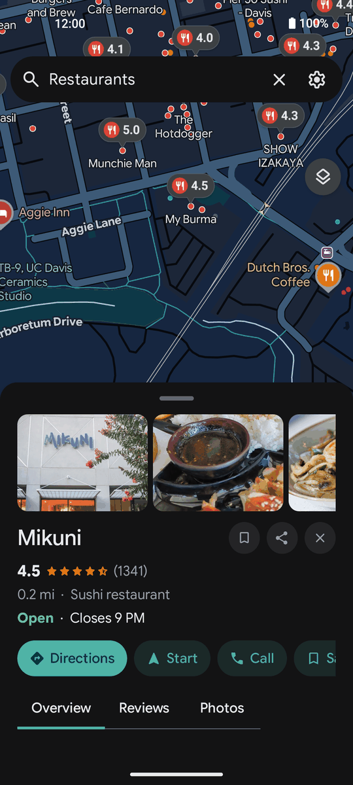</td>
    <td align="center">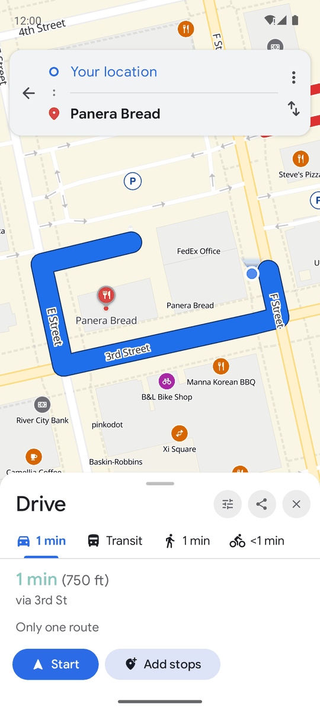</td>
    <td align="center">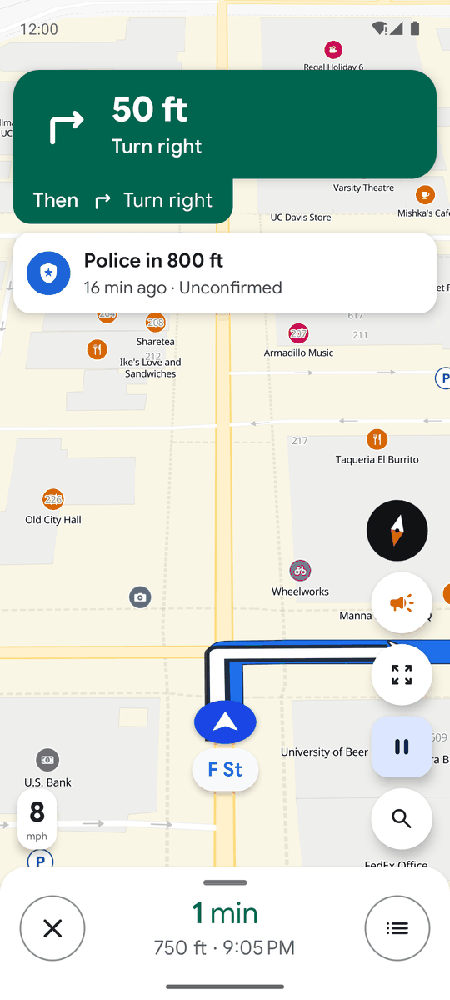</td>
  </tr>
  <tr>
    <td align="center">Mapa</td>
    <td align="center">Lugar</td>
    <td align="center">Ruta</td>
    <td align="center">Navegación con aviso</td>
  </tr>
</table>

<table>
  <tr>
    <td align="center"></td>
    <td align="center">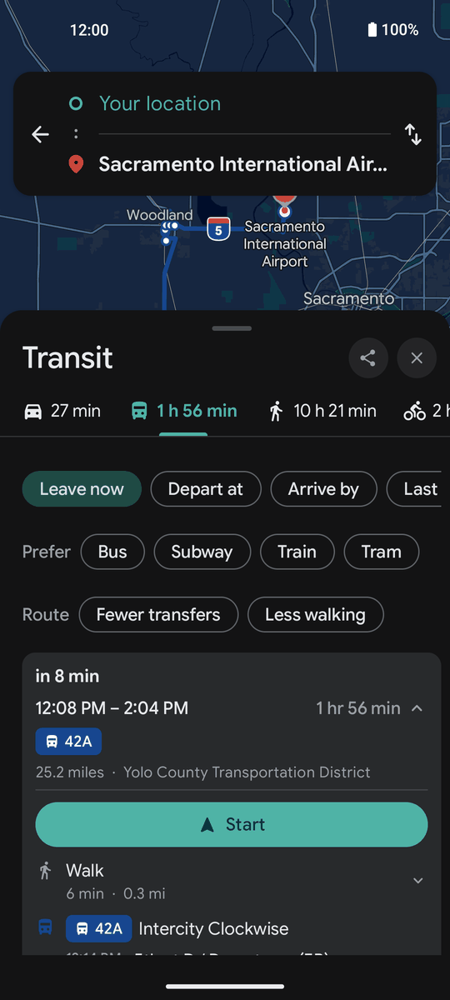</td>
    <td align="center">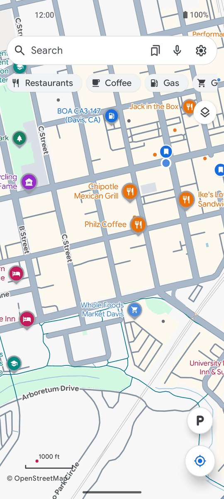</td>
  </tr>
  <tr>
    <td align="center">Tipos de mapa y capas</td>
    <td align="center">Transporte público</td>
    <td align="center">Tema claro</td>
  </tr>
</table>

### De la web a Android

El botón **Continuar en Android** del planificador abre el mismo plan en la app. La URL v1
usa los mismos nombres de parámetros en la web y en Android, y la asociación de enlaces HTTPS
se sirve en `/.well-known/assetlinks.json`.

## Desarrollo

Requisitos: Node.js 22+ y pnpm 10+. Este paquete depende de paquetes del monorepo
(`@astian-maps/contracts`, `i18n`, `design-tokens` y `@astian/map-style`), así que se
ejecuta desde el monorepo.

```bash
cp .env.example .env.local
pnpm install --frozen-lockfile
pnpm --filter @astian-maps/web dev      # http://localhost:3000
```

| Comando | Qué hace |
| --- | --- |
| `pnpm dev` | Servidor de desarrollo. Compila y sincroniza estilos, worker de MapLibre y calibración antes de arrancar. |
| `pnpm build` | Compilación de producción. |
| `pnpm start` | Sirve la compilación de producción. |
| `pnpm typecheck` | Comprobación de tipos con `tsc --noEmit`. |
| `pnpm test` | Pruebas con Vitest. |

### Configuración

Las variables están documentadas en [`.env.example`](.env.example). Las principales:

| Variable | Uso |
| --- | --- |
| `NEXT_PUBLIC_API_URL` | API de Astian Maps (`http://localhost:8000/v1` en local). Sirve búsqueda, rutas y reportes. |
| `NEXT_PUBLIC_MAPS_WEB_URL` | Origen público para enlaces HTTPS y rutas compartidas. |
| `ASTIAN_TILE_SERVER_URL` | Origen de Martin que usa el proxy `/tiles`. |
| `ASTIAN_ANDROID_SHA256_CERT_FINGERPRINTS` | Huellas del certificado de release para los App Links. Vacío en local. |
| `NEXT_PUBLIC_MAP_START` | Cámara inicial como `latitud,longitud,zoom`. |

`.env.local` queda fuera del repositorio. Las capas de evaluación (satélite, terreno y rutas
ciclistas) y los tiles comunitarios son solo para desarrollo y un proceso con
`NODE_ENV=production` los rechaza.

### Probar los reportes de la comunidad en local

Con la API local en marcha (`services/api`), se puede crear un reporte de prueba:

```bash
curl -X POST http://localhost:8000/v1/incidents \
  -H 'content-type: application/json' \
  -d '{"type":"police","subtype":"hidden","coordinates":{"latitude":38.543,"longitude":-121.739},"reporterKey":"local-dev-reporter-key","source":"android"}'
```

Aparece en el mapa web en unos segundos. Para probarlo desde un teléfono por USB, el script
`scripts/dev-phone.sh` del monorepo redirige los puertos 8000 y 3000 con `adb reverse`.

## Estructura

```text
app/          Rutas de Next.js: mapa, planificador, proxy de tiles y App Links
components/   MapExplorer, MapCanvas, PlaceDetail y CommunityIncidents
lib/          API, rutas compartibles, capas, estilos, incidentes y pruebas
public/       Estilos, sprites, glifos, iconos y los SVG de cada tipo de reporte
scripts/      Sincronización de estilos, worker de MapLibre y calibración
docs/         Logo y capturas de este README
```

## Atribución y licencia

Datos de [OpenStreetMap](https://www.openstreetmap.org/copyright) (ODbL) y teselas
[OpenMapTiles](https://openmaptiles.org/). Licencia Apache-2.0. La app Android es una
derivada de Vela y se distribuye bajo GPL-3.0; consulta su
[`NOTICE.md`](https://github.com/goastian/astian-maps-android/blob/main/NOTICE.md).
